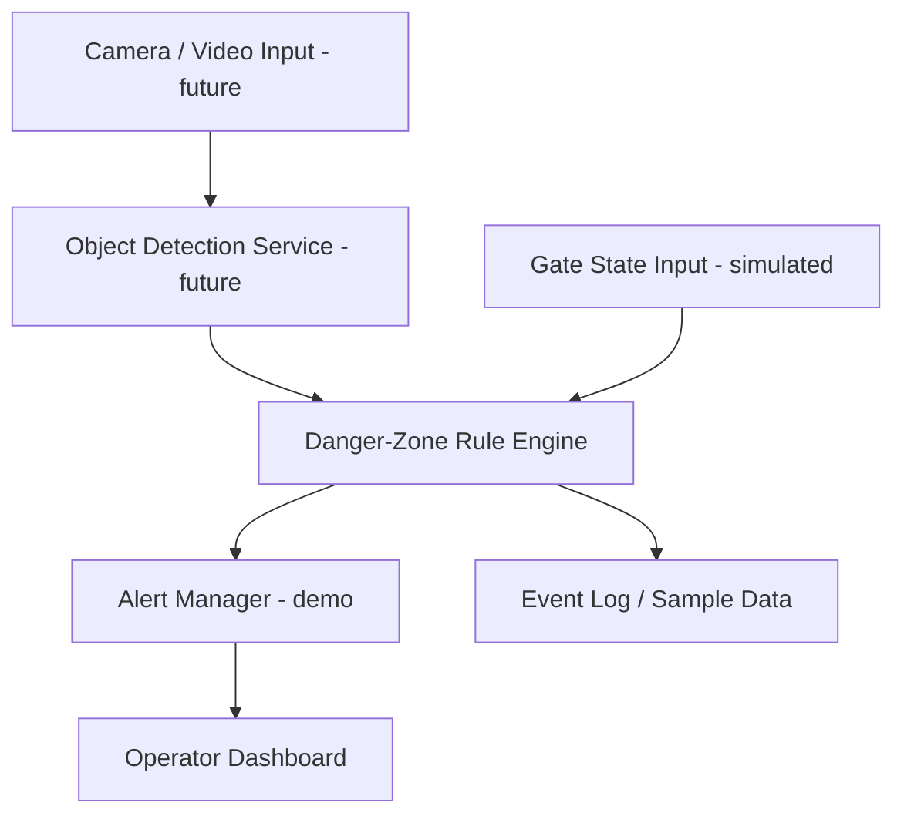

# Technical Design Document — RailGuard AI

## 1. Goal
Demonstrate the concept of detecting a person/two-wheeler in a railway crossing danger zone while the gate is closed and presenting an operator-facing alert.

## 2. Architecture

## 3. Current prototype implementation
- **UI:** HTML, CSS, JavaScript dashboard.
- **Detection input:** hard-coded simulated events; no live camera inference.
- **Rule engine:** unsafe if gate is closed AND object is in danger zone.
- **Alerts:** visual dashboard status only; no external notification.
- **Data:** synthetic examples in `data/sample_events.json`.

## 4. Event rule
`unsafe = gate_closed AND in_danger_zone`

Object categories in the sample data are pedestrian, two-wheeler, and unknown. Unknown detections should be reviewed cautiously in a future production design.

## 5. Setup and configuration
Open `index.html` in a modern browser. There are no environment variables or API keys in this demo. Tests require Python 3.9+ and use the standard library.

## 6. Validation plan / test cases
1. Gate closed + person in danger zone → alert expected.
2. Gate closed + two-wheeler in danger zone → alert expected.
3. Gate open + zone clear → no alert expected.
4. Gate closed + zone clear → no alert expected.

Run tests: `python -m unittest discover -s tests -v`

## 7. Security, privacy, and fail-safe requirements for future work
- Use authorized camera feeds only; minimize and protect personal data.
- Authenticate operator access and encrypt communications.
- Log events with timestamps and audit controls.
- Define safe behavior for sensor/network failures and uncertain detections.
- Validate on representative data and assess false positives/negatives.
- Do not connect a student prototype to real signalling or gate controls.
- Obtain railway-authority approval and independent safety assessment before any operational trial.

## 8. Limitations
This is a proof-of-concept UI and rule simulation. It does not include a trained ML model, camera processing, real-time gate-state integration, or operator messaging. It is not safety-certified.
